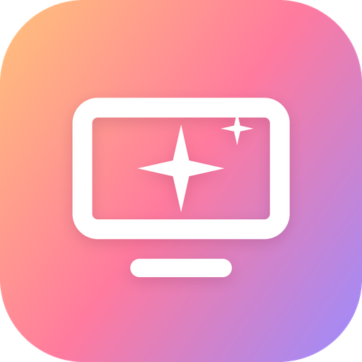
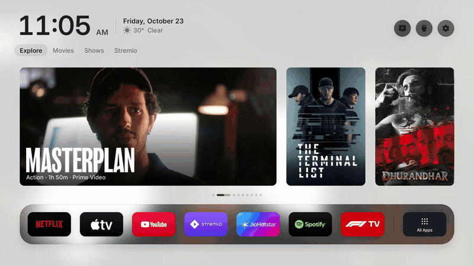
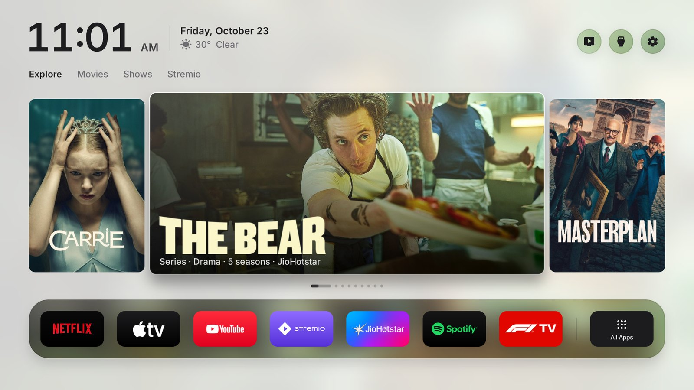
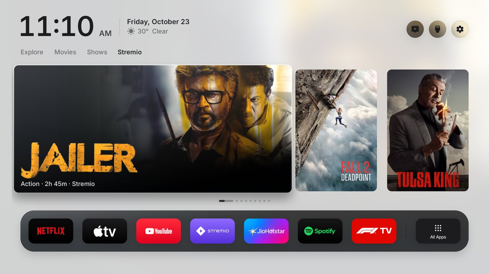
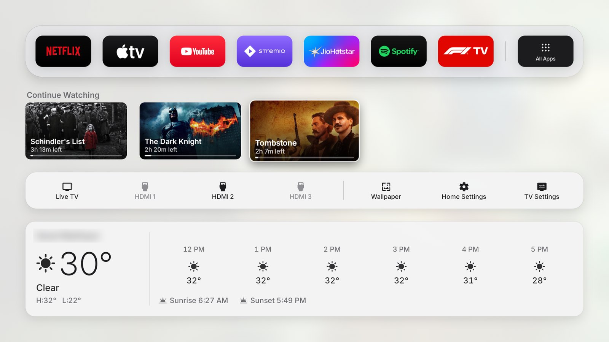

<div align="center">



# Lumen TV

**A calm, ad-free, Apple TV–style home screen for Google TV and Android TV.**

Real posters, title logos and a Continue Watching row, with suggestions from the apps you already pay for.<br>
Set up in about 30 minutes with Claude Code. One button brings back your TV's original home screen.

[Install](#install) · [Which TVs](#which-tvs) · [What's new](CHANGES.md) · [Full setup guide](SETUP.md) · [Going back](#going-back)

<a href="docs/demo.mp4"></a>

<sub>25-second tour, recorded on the TV. <a href="docs/demo.mp4">Watch it in full quality (MP4)</a>.</sub>

</div>

> Lumen TV is a fork of [**Free My TV**](https://github.com/simbasjungles/free-my-tv) by the Free My TV contributors
> (MIT). It keeps everything that project does, safely switching the home screen with one-button undo, and adds
> a redesigned look and new features, first built and tuned on a Vu 75″ Vibe Google TV. See [CHANGES.md](CHANGES.md).

## What you get

- **No ads, no sponsored rows.** Just your apps and good suggestions.
- **Suggestions with real art.** Official posters and title logos, like Apple TV. A mix of popular titles from your
  country (set `tmdb_origin`, e.g. India) and the big worldwide hits, all well rated and all on apps you have.
- **Opens the title, not just the app.** With a free Watchmode key, choosing a card opens that movie or show's page
  in Netflix, Prime Video, JioHotstar, Sony LIV and others.
- **A Stremio tab.** Popular titles that open straight on their page in Stremio, where your add-ons find the streams.
- **Continue Watching.** What you opened from the home screen, plus your real Stremio progress (time left and a
  progress line). Hold OK on a card to remove it.
- **A second page one press down.** Continue Watching, your HDMI inputs and shortcuts in one dock, and the weather.
- **Frosted glass, wallpapers and soft click sounds.** A large clock, light or dark by your city's sunset, and a
  screensaver that matches.
- **Fast.** Suggestion images are ready as soon as the TV turns on; the home screen uses no CPU while you're in an app.
- **Safe.** No root, nothing uninstalled, and one button brings the factory home screen back.

<p align="center">

</p>
<p align="center">


</p>

## Install

### With Claude Code (recommended)

You don't need to know how to code. You'll need a **computer on the same Wi-Fi as the TV** and about 30–45 minutes.

1. **On the TV:** turn on *Developer options* and *USB debugging* (or *Network debugging*), and note the TV's IP
   address. [How, step by step →](SETUP.md#2-get-the-tv-ready)
2. **On the computer:** install [Claude Code](https://claude.com/claude-code) and open it in an empty folder.
3. **Paste this**, with your own details:

   > Set up Lumen TV on my TV from https://github.com/itsamiiir/lumen-tv. My TV's IP is 192.168.1.50 and I live in
   > Jaipur, India.

Claude downloads this project, reads its instructions ([CLAUDE.md](CLAUDE.md)), installs the tools it needs, and
walks you through the rest, asking before anything that changes your TV or computer. The [full guide](SETUP.md)
explains every step, including the free keys and what to do if something goes wrong.

### By hand

If you're comfortable with a terminal: JDK 17+, the Android SDK (build-tools 34, platform 34) and adb, then:

```bash
git clone https://github.com/itsamiiir/lumen-tv && cd lumen-tv
./build.sh                      # first run creates config.properties: fill it in, then run it again
adb connect <TV-IP>:5555
adb install -r FreeMyTV.apk
```

Then on the TV: *Free My TV* → *Home Screen* → *Free My TV*.

## Which TVs

**Requirement: Google TV or Android TV, Android 9 (Pie) or newer.** To check, on the TV open *Settings → System →
About* and look at *Android TV OS version*.

| Tested on | Android | Tested by |
|---|---|---|
| Vu 75″ Smartchoice Vibe (75VIBE-DV, Google TV) | 12 | Lumen TV |
| TCL Google TV (98″, MediaTek) | 14 | Free My TV |
| Sony BRAVIA (VH22) | 12 | Free My TV |
| Vestel-made TVs (F&U and other store brands) | 14 | Free My TV |
| KTC-made TVs (NextStar, Google TV) | 14 | Free My TV |
| Xiaomi projectors by Formovie (L1, Google TV) | 14 | Free My TV |
| Mi Box 3 | 9 | Free My TV |

Android 9 to 11 run a lighter graphics mode (no GPU layers, cached shadows) so older chips stay smooth. The fancier
frosted glass shaders need Android 13; on 9 to 12 the glass is drawn with simpler fills.

| TV | Works? |
|---|---|
| **Google TV / Android TV, Android 9 or newer**: Sony Bravia, TCL, Vu, Xiaomi, Hisense, Philips, OnePlus, Toshiba (Android models) | ✅ Yes. Built and tested on a Vu 75″ Vibe (Google TV, Android 12). |
| **Streamers**: Chromecast with Google TV, Google TV Streamer, NVIDIA Shield, Mi Box, onn 4K | ✅ Yes, and the easy way to bring it to **any** TV with HDMI. |
| **Samsung (Tizen), LG (webOS)** | ⚠️ Only the original Free My TV's web version, without Lumen's redesign. |
| **Fire TV, Roku, Apple TV** | ❌ No (plug in a Google TV streamer instead). |

**Not a Vu?** Every brand has its own built-in apps (picture, sound, HDMI) that must be left alone and its own promo
apps that can be turned off. Claude Code checks your TV and adds them before switching; it's part of the setup.
Older or 1 GB TVs get a lighter graphics mode automatically.

## Settings

Most settings are on the TV: *Free My TV* → *Home Settings* (language, suggestions on/off, wallpaper, sounds,
temperature, weather, your city) and *Shelf* (which apps, in which order). The rest are in `config.properties`, built into the app:

| Setting | What it does |
|---|---|
| `tmdb_key` | Needed for suggestions. Free from [themoviedb.org](https://www.themoviedb.org/settings/api). |
| `tmdb_region` | Your country, for which app streams what (`IN`, `US`, `GB`…). |
| `tmdb_origin` | Mix your country's popular titles with worldwide hits (e.g. `IN`). Empty = worldwide only. |
| `family_friendly` | `true` leaves out titles with sexual content. |
| `watchmode_key` | Optional, free from [Watchmode](https://api.watchmode.com/requestApiKey/): cards open the title in its app. |
| `stremio_auth_key` | Optional: your Stremio progress in Continue Watching. Created by `tools/stremio-key.sh`. |
| `latitude`, `longitude`, `city` | Weather and sunset. |

**Your keys are private.** They're never committed (`config.properties` is in `.gitignore`), and you type them into
the file yourself, never into a chat. The app you build has them inside, so **don't share your `FreeMyTV.apk`**;
others should build their own.

## Going back

On the TV: *Free My TV* → *Home Screen* → *Original*. The factory home screen, screensaver and every app come back
as they were. If the new home screen ever crashes three times in five minutes, it switches back by itself.

To remove it for good: switch to *Original*, then uninstall *Free My TV* (Settings → Apps).

## What it changes on your TV

- It becomes the home screen and the screensaver.
- It turns off, without uninstalling, the stock home screen and a short list of promo apps for your brand.
- Picture, sound, inputs, remote pairing, Google services and the Play Store are on a protected list, checked before
  every change.
- Apps that saved a Wi-Fi network are never turned off (Android would erase the network).

## How it works

A plain Android app (Java, no Gradle, no libraries) built by [`build.sh`](build.sh) into a 2 MB APK. It switches
the home screen through the TV's own ADB from inside the TV, and draws everything by hand on one Canvas. Suggestions
come from TMDB, links from Watchmode, Stremio progress from your Stremio account, weather from Open-Meteo. The code
map is in [CLAUDE.md](CLAUDE.md#the-code).

## Privacy

No accounts of ours, no analytics, no tracking. The app talks to TMDB, Open-Meteo (with your coordinates), Watchmode
and Stremio only when you set their keys, and Binance only when `show_crypto=true`. Your settings stay on your
computer and your TV.

## Credits

- Based on [Free My TV](https://github.com/simbasjungles/free-my-tv) by the Free My TV contributors (MIT).
- Built with [Claude Code](https://claude.com/claude-code).
- Home screen sounds: rendered from [cuelume](https://github.com/danielwh2/cuelume) by Daniel Belyi (MIT); licence in
  `app/assets/sfx/LICENSE-cuelume.txt`.
- The LG version builds on [FreeMyTvWebOS](https://github.com/danielthejoker18/FreeMyTvWebOS) (MIT); Samsung installs
  use [TizenBrew Installer](https://github.com/reisxd/TizenBrewInstaller).
- This product uses the TMDB API but is not endorsed or certified by [TMDB](https://www.themoviedb.org/). Links to the
  titles by [Watchmode](https://api.watchmode.com/). Weather by [Open-Meteo.com](https://open-meteo.com/) (CC BY 4.0).
- Icons: [Material Symbols](https://fonts.google.com/icons) (Apache 2.0). Font: [Inter](https://rsms.me/inter/)
  (SIL OFL 1.1). Coin logos: [cryptocurrency-icons](https://github.com/spothq/cryptocurrency-icons) (CC0).
- Not affiliated with Google, Vu, Stremio or any streaming service. App names and logos belong to their owners.

## License

[MIT](LICENSE). Fork it, change it, ship it.
